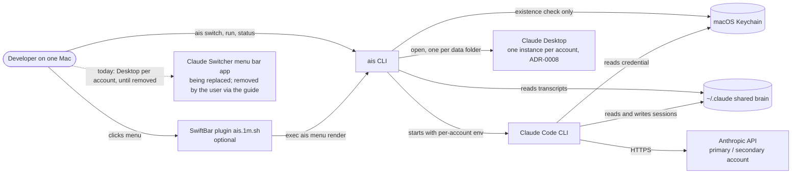
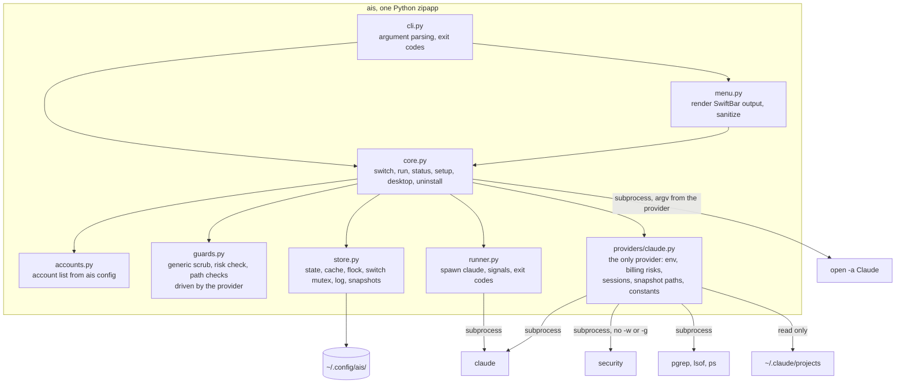

# Architecture
Status: Approved 2026-10-16

Inputs: `docs/brief.md`, the approved design spec and `docs/requirements.md`
v0.4. Decisions live in `docs/adr/`. ADRs 0002, 0006, 0007 and 0008 depend on
the G-1 spike; if it disproves them, a superseding ADR comes first.

## System context (C4 L1)

## Containers (C4 L2)

## Data model and ownership

| Entity | File | Owner | Notes |
|---|---|---|---|
| Account list, acknowledgements, menu privacy | `~/.config/ais/config.json` | `core.py setup` writes, `accounts.py` reads, `core.py` adds acks | credDir is one canonical string (ADR-0002); unknown `version` exits 78 |
| Last-used account per session, plugin installed flag | `~/.config/ais/state.json` | `store.py` | flock + temp file + rename (ADR-0003); entries for missing transcripts pruned |
| Cache | `~/.config/ais/cache.json` | `core.py` (through `store.update_json`) | `claude auth status` results (10 min); session folder and title per transcript keyed by path, mtime, size |
| Switch mutex | `~/.config/ais/switch.lock` | `store.py` | flock held from the open check to the spawn; open sessions come from `claude` process cwd (provider) |
| Event log | `~/.config/ais/ais.log` (+ `.1`) | `store.py` | `O_APPEND`, 0600, 1 MB rotation (ADR-0005) |
| Session snapshots | `~/.config/ais/snapshots/` | `store.py` copies the paths the provider names | APFS clone where possible; at most 20, 500 MB, 30 days |
| Menu plugin | `<SwiftBar plugin folder>/ais.1m.sh` | `core.py menu install` | one line, no logic (ADR-0007) |
| Sessions, memory, settings | `~/.claude/`, `~/.claude.json` | Claude Code | ais only reads (realpath-checked) |
| Credential folders | `~/.claude-accounts/<id>` | Claude Code (Keychain slot key) | ais never writes inside |
| Credentials | macOS Keychain | Claude Code | ais only runs `claude auth status` or checks the item exists |
| Desktop data folders | `~/Library/Application Support/Claude-ais-<account>`, or the account's `desktop_data_dir` (default account: Claude.app's own folder) | Claude Desktop | ais passes the path with `--user-data-dir`; the menu reads only `config.json`'s `lastKnownAccountUuid`, the session records and `plan-usage-history.json`; never writes or deletes (ADR-0008, ADR-0009) |

## Interfaces (link openapi.yaml / *.proto)

No network API. The interfaces are:

- **CLI:** `ais setup | login | run | switch | status | desktop | menu install |
  menu uninstall | menu render | uninstall`, flags and exit codes as in
  `docs/requirements.md` (sysexits 64 to 78; otherwise `claude`'s code).
- **Provider interface** (`providers/base.py`, a `typing.Protocol`):
  `env_for`, `resume_command`, `start_command`, `login_command`,
  `env_for`, `billing_risks`, `newest_session`, `recent_sessions`,
  `find_session`, `open_session_pid`, `has_credential`, `snapshot_paths`,
  `self_check`, `limit_time`, and `desktop_data_dir`,
  `desktop_launch_command`, `desktop_running_pid` (see FR-5.1, FR-6). Registered in a static table
  (FR-5.2).
- **`ais status --json`:** schema in FR-4.6.
- **SwiftBar plugin:** `ais.1m.sh` hides SwiftBar's own menu items, sets
  `PATH` and runs `exec ais menu render`; all logic and sanitizing are in `menu.py`.

## Cross-cutting: auth, config, observability, errors

- **Auth:** ais holds no credentials. Account selection is the
  per-account Keychain slot chosen by `CLAUDE_SECURESTORAGE_CONFIG_DIR`,
  passed as the exact stored credDir string and omitted entirely for the
  default account (ADR-0002). The provider supplies the environment
  (`env_for`) and the list of billing or account risks (`billing_risks`);
  `guards.py` applies them generically.
- **Config:** ais's own `~/.config/ais/config.json`; never Claude
  Switcher's files. Validation at load: account ids match the NFR-SEC
  pattern, credDir rules of FR-1.7.
- **Concurrency:** read-modify-write of ais files and log rotation under
  one `fcntl.flock`, never held while waiting for input; open sessions
  detected by `claude` process cwd (one batched `pgrep` + `lsof` per
  call); a switch holds the switch mutex from the open check to the
  spawn. Fallback if G-1(e) fails: one global lock, one `claude` at a
  time.
- **Signals:** `runner.py` starts `claude` with default handlers, then
  ignores SIGINT and SIGQUIT in ais only, forwards SIGHUP and SIGTERM,
  releases locks in `finally`, and maps a signal death to 128+N.
- **Menu:** every subprocess has a timeout and a process-group kill;
  render finishes within 5 s.
- **Observability:** one append-only log line per state-changing command,
  plus the switch time computed from the transcript (ADR-0005).
- **Errors:** every failure path maps to an exit code and one
  plain-language line on stderr. No stack traces unless `AIS_DEBUG=1`.

## Deployment: envs, IaC, CI/CD, rollback

- **Envs:** one: the user's Mac (ADR-0004). No servers, no IaC.
- **Build:** `python3 -m zipapp` produces `dist/ais`; `make install`
  copies it to `~/.local/bin/ais`.
- **CI:** GitHub Actions: Linux on Python 3.9 and 3.12 with fake `claude`,
  `security`, `pgrep`, `lsof`, `ps` and `open`; one `macos-latest` job on Python 3.9 for
  path normalization (NFD), `lsof`/`pgrep` parsing and menu rendering.
- **Rollback:** `make install` keeps the previous binary as
  `~/.local/bin/ais.prev`; `ais uninstall` removes ais's config and keeps
  snapshots.

## Threat model: assets, trust boundaries, top threats

**Assets:** the two account credentials (Keychain); session transcripts
and memory in `~/.claude` (may hold pasted secrets and work data); ais
snapshots (copies of transcripts).

**Trust boundaries:** (1) the shell environment ais inherits; (2) files ais
reads that other programs write (`~/.claude`, `~/.claude.json`, settings
files), including model-generated transcript text; (3) the Keychain;
(4) SwiftBar, which turns ais's output into clickable actions; (5) the
network boundary to Anthropic (Claude Code's, not ais's).

| # | Threat | Mitigation | NFR-SEC item |
|---|---|---|---|
| T1 | ais reads or leaks a token (log, snapshot, `security -w`) | never calls `security` with `-w`/`-g`; logs no arguments; snapshots copy only transcripts | "secrets from macOS Keychain, never read, printed, logged or copied" |
| T2 | Inherited env or settings route billing or pin one account (`ANTHROPIC_API_KEY`, `CLAUDE_CODE_OAUTH_TOKEN`, `apiKeyHelper`, inherited `CLAUDE_SECURESTORAGE_CONFIG_DIR`); `ais run -- --resume` bypassing switch checks | provider `billing_risks` over env, all settings scopes and `--settings`; env scrub (FR-1.3, FR-2.1, FR-2.2); `run` rejects resume flags (FR-3.15) | "input validated at the CLI boundary" |
| T3 | Path tricks: symlink under `~/.claude/projects`, crafted session folder or credDir | per-kind allowed roots with realpath; UUID and account regex; static provider table | "allowed roots per path kind, checked with realpath" |
| T4 | Work data sent under the personal account without the user knowing | per-pair acknowledgement (FR-2.8); shared-memory statement (FR-2.7); label printed on every launch; G-3 rule | "cross-account transcript sending only after the FR-2.8 acknowledgement" |
| T5 | Snapshots readable by other local users, or kept forever | 0600 files, 0700 directories; at most 20, 500 MB, 30 days; uninstall asks to delete them | "files 0600, directories 0700" |
| T6 | Menu injection: a transcript title or folder containing `\|`, `bash=` or newlines becomes a SwiftBar action | sanitize every transcript-derived field; actions carry only UUID and account; ais re-validates the folder (FR-4.8, FR-4.12, FR-3.4) | "transcript and file-system text sanitized before it reaches the menu" |

## Rules for agents: no new service, dependency or datastore without an ADR

- No new service, dependency or datastore without an ADR. Standard
  library only (ADR-0001).
- Never write to `~/.claude`, `~/.claude.json`, `~/.claude-accounts/`, the
  Keychain or Claude Switcher's files.
- Never set `CLAUDE_CONFIG_DIR`. Never pass `CLAUDE_SECURESTORAGE_CONFIG_DIR`
  as an empty string; omit it for the default account; never re-spell a
  stored credDir.
- Never call `security` with `-w` or `-g`.
- Never put transcript or file-system text into a SwiftBar action.
- Provider-specific code and constants live only in `providers/<name>.py`.

## Review log
Fresh-context review 2026-10-16 (red-team subagent, files only). The user accepted the recommendations as a set.
- [blocker] B1 "`claude --continue` for the newest session" leaves ais without a session ID → accepted: provider resolves the ID, always `--resume <id>`; ADR-0006 revised.
- [blocker] B2 transcript text reaches SwiftBar actions → accepted: T6, sanitizing, UUID-only actions.
- [major] M1 runtime reads `docs/spike-results.md` → accepted: constants in `providers/claude.py`.
- [major] M2 credDir containment and hash identity → accepted: canonical string, per-kind roots; ADR-0002 updated.
- [major] M3 `lsof` unproven, lock race → accepted: process-cwd detection, `O_EXCL` lock with start time, G-1(g).
- [major] M4 signal handling → accepted: `runner.py` rules.
- [major] M5 switch metric untestable → accepted: computed from the transcript.
- [major] M6 plugin needs `jq`/`timeout` → accepted: one-line plugin, logic in `menu.py`; ADR-0007 updated.
- [major] M7 status every minute may prompt or be slow → accepted: cache, Keychain-only check in the menu, G-1(h).
- [major] M8 billing guard gaps → accepted: `CLAUDE_CODE_OAUTH_TOKEN`, all settings scopes, `--settings`.
- [major] M9 secondary plan with no decision rule → accepted: G-3 rule, per-pair ack, shared-memory statement.
- [major] M10 accepted ADRs on unproven premises → accepted in part: ADRs stay Accepted with "Depends on: G-1"; G-1(g) to (j) added; global-lock fallback pre-decided.
- [major] M11 full `~/.claude` backup → accepted: dropped; session snapshots with subagent files.
- [major] M12 CI never runs macOS → accepted: one `macos-latest` job; ADR-0004 updated.
- [minor] m1 to m8 → accepted: PATH-only zshrc line, tri-state menu, sysexits codes, flock, cd into session folder, terms defined, uninstall via `state.json`, log rotation.
- [alt] 1 shell-function MVP → rejected: the user asked for an intuitive, robust tool with easy setup.
- [alt] 2 always name the account → rejected: "switch to the other one" is the intuitive default and B1 makes it reliable.
- [alt] 3 drop the tar backup → accepted (same as M11).
- [alt] 4 postpone the SwiftBar menu → rejected: the user chose it; B2, M6 and M7 cover its risks.
- Plan reviews 2026-10-16 (red-team and architecture-guardian) changed this file: provider owns env and billing risks; core owns the cache; PID lock files replaced by process-cwd detection plus a switch mutex; snapshots via provider paths, APFS clones and caps; signal handling after spawn; menu subprocess timeouts. Details in `docs/requirements.md` (v0.4) and the plan's Review log.
